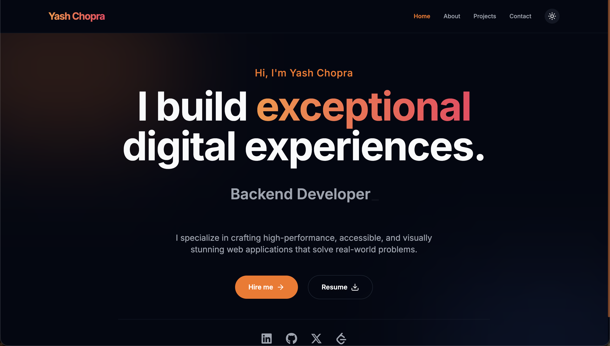

<div align="center">

# Yash Chopra — Portfolio

**Full Stack & Web3 Engineer** · building on Solana, Ethereum and Robinhood Chain

[](https://yashchopraportfolio.vercel.app/)
[](https://nextjs.org/)
[](https://www.typescriptlang.org/)
[](https://tailwindcss.com/)



</div>

## ✨ Highlights

- **Futuristic UI**: an animated aurora and grid backdrop, a light that follows your cursor, conic "glow" borders, glass surfaces and a 3D tilt code card in the hero.
- **Dark and light themes**: dark by default, with a toggle that reveals the new theme in a circle from the click point (View Transitions API). It falls back gracefully in browsers without it.
- **Motion with restraint**: framer-motion reveals and layout animations that respect `prefers-reduced-motion`.
- **Filterable projects**: Web3 and full-stack filters, large featured cards, and live and source links for every project.
- **Working contact form**: validated with React Hook Form and delivered via Nodemailer through a Next.js route handler.
- **SEO-ready**: per-page metadata, Open Graph and Twitter cards, and Vercel Analytics.

## 🚀 Featured projects

| Project | What it is | Stack | Links |
| --- | --- | --- | --- |
| **HoodPad** | Non-custodial memecoin launchpad on Robinhood Chain. Launch an ERC-20 in one transaction, trade it on a bonding curve, then graduate it to Uniswap V2 with burned LP. | Solidity · Foundry · OpenZeppelin · Next.js · TypeScript | [Live](https://hoodpad-a-robinhood-meme-launchpad.vercel.app/) · [Code](https://github.com/YashChopra25/HoodPad---A-Robinhood-meme-launchpad) |
| **VaultWill (Inheritance Protocol)** | Dead-man's-switch wills on Solana. Seal files on IPFS and name weighted heirs. A release needs both owner inactivity and an M-of-N custodian quorum. | Rust · Anchor · Solana · IPFS · Next.js | [Live](https://inheritance-protocol-rahp.vercel.app/) · [Code](https://github.com/YashChopra25/inheritance_protocol) |
| **ChainView** | Real-time Solana analytics dashboard | Web3.js · Metaplex · Next.js | [Live](https://chain-view-web3.vercel.app/) · [Code](https://github.com/YashChopra25/ChainView-Web3) |
| **Yatirly** | URL shortener & QR code generator | React · Express · Prisma · TypeScript | [Live](https://yatirly.yashchopra.tech/) · [Code](https://github.com/YashChopra25/Yatirly) |

More projects are on the [projects page](https://yashchopraportfolio.vercel.app/project).

## 🧱 Tech stack

| Layer | Tools |
| --- | --- |
| Framework | Next.js 14 (App Router), React 18, TypeScript |
| Styling | Tailwind CSS with HSL design tokens, `next-themes` |
| Motion | Framer Motion, CSS `@property` animations, View Transitions API |
| Forms & email | React Hook Form, Axios, Nodemailer, react-hot-toast |
| Fonts | Space Grotesk (display), Inter (body), JetBrains Mono (code) via `next/font` |
| Deploy | Vercel, plus a GitHub Actions → self-hosted PM2 pipeline |

## 📁 Project structure

```
src/app
├── _components/          # UI building blocks
│   ├── Background.tsx    # aurora + grid + cursor spotlight
│   ├── Navbar.tsx        # floating glass nav
│   ├── ThemeToggle.tsx   # circular view-transition theme switch
│   ├── Hero.tsx          # headline, typewriter, 3D code card
│   ├── ProjectCard.tsx   # spotlight/glow project cards
│   ├── ProjectGrid.tsx   # filterable project grid
│   └── ...
├── _utilities/
│   ├── datafileds/       # Projects, Experience, Education, Skills, Socials
│   └── mailer/           # Nodemailer transport
├── api/sendmessage/      # contact form route handler
├── about/  project/  contact/
├── globals.css           # theme tokens + glow/glass/grid utilities
└── layout.tsx
```

To add or edit a project, update `src/app/_utilities/datafileds/Project.ts`. Setting `featured: true` gives the project a large card on the home page.

## 🛠️ Getting started

```bash
git clone https://github.com/YashChopra25/PortFolio-YashChopra.git
cd PortFolio-YashChopra
npm install
npm run dev
```

Open [http://localhost:3000](http://localhost:3000).

### Environment variables

Create a `.env` file in the project root:

```env
# Contact form (Gmail SMTP; use an app password)
EMAIL_USER=you@gmail.com
EMAIL_PASSWORD=your-app-password
EMAIL_USER_SEND_TO=where-messages-go@example.com

# Optional: shows a "Resume" button in the hero
RESUME_DRIVE_LINK=https://link-to-your-resume
```

### Scripts

| Command | Description |
| --- | --- |
| `npm run dev` | Start the dev server |
| `npm run build` | Create a production build |
| `npm run start` | Serve the production build |
| `npm run lint` | Run ESLint |

## 📬 Connect

[GitHub](https://github.com/YashChopra25) · [LinkedIn](https://www.linkedin.com/in/yashchopra25/) · [X](https://twitter.com/YashChopra25) · [LeetCode](https://leetcode.com/YashChopra25/)

Feedback and ideas for improvements are always welcome. Feel free to open an issue.
